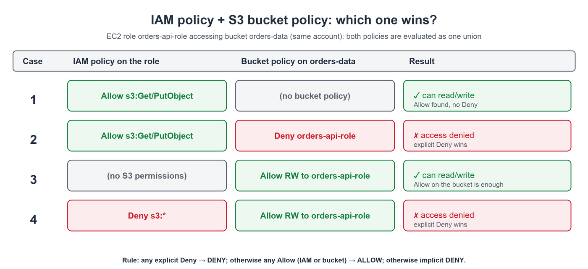
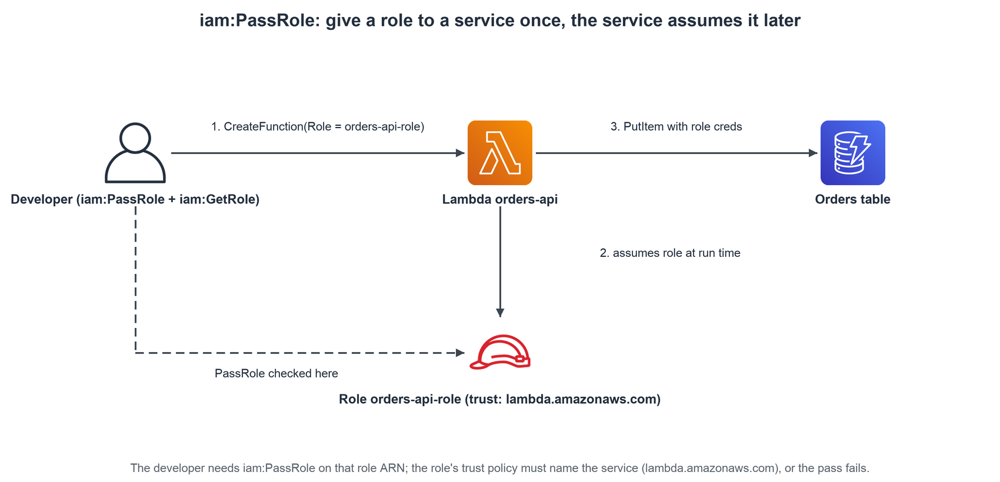
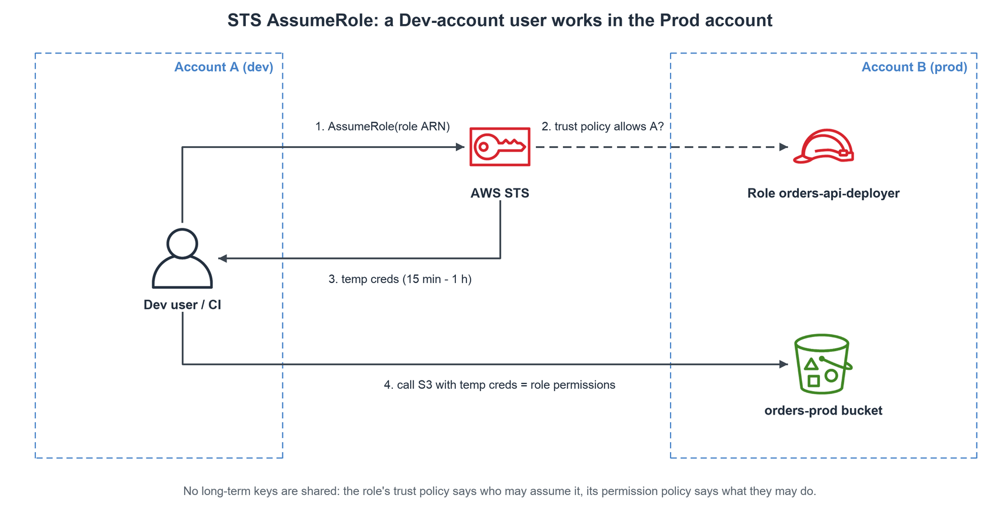

# Identity and Access Management

## IAM Fundamentals

### Overview

- Manages access to AWS services and resources securely.
- Global Service (users, groups, roles, policies are global).

### Principals

- **Users**
    - End users (people, applications) needing long-term credentials. Have password for Console access, Access Keys for programmatic access (CLI/SDK).
- **Groups**
    - Collections of IAM Users. Cannot contain other groups. Simplifies permission management by assigning policies to groups.
    - Example: a user can belong to several groups (e.g. Developers, Audit Team, Operations); a user may also belong to no group.
- **Roles**
    - Intended to be assumed by trusted entities (Users, AWS Services, Applications, other AWS accounts). Provide temporary security credentials. Do not have standard long-term credentials like passwords or access keys.
        - Use Cases: Granting AWS service permissions (e.g., EC2 Role, Lambda Role), Cross-Account Access, Identity Federation.

### Permissions

- **Policies**
    - JSON documents defining permissions. Attached to Users, Groups, or Roles (Identity-based) or Resources (Resource-based).
        - Structure: Version, Statement (containing Sid, Effect, Principal, Action, Resource, Condition).
        - `Effect`: Allow or Deny.
        - `Action`: API calls allowed/denied (e.g., `s3:GetObject`, `ec2:RunInstances`).
        - `Resource`: ARN(s) the actions apply to.
        - `Principal`: (Mainly in Resource-based policies) The user, account, service, or entity allowed/denied access.
        - `Condition`: Optional criteria for policy enforcement (e.g., time, source IP, MFA status).

### Security Features

- **Multi-Factor Authentication (MFA)**: Recommended for enhanced security.
- **Password Policy**: Enforce password complexity and rotation rules.

### Programmatic Access

- **AWS CLI**: Manage AWS services via command line.
- **AWS SDK**: Manage AWS services programmatically within applications.
- **Access Keys**: Long-term credentials (Access Key ID & Secret Access Key) used for CLI/SDK access.

### Auditing

- **IAM Credential Report**: Lists all account users and the status of their credentials.
- **IAM Access Advisor**: Shows service permissions granted to a user/role and when those services were last accessed.

## Advanced IAM Concepts

### Resource-based Policies

- Attached directly to resources (e.g., S3 Buckets, SQS Queues, SNS Topics).
- Specify `Principal` allowed/denied access.
- Enables cross-account access without roles; the principal retains their original permissions.

### IAM Policy Evaluation Logic

- Explicit **Deny** in any applicable policy (Identity, Resource, SCP, Permissions Boundary, Session) always overrides any **Allow**.
- If no explicit Deny, an explicit **Allow** is required from all applicable policy types (SCP, Resource, Identity, Permissions Boundary, Session).
- If no explicit Allow matches, access is implicitly denied.
- Evaluation flow
    - **Deny evaluation**: Decision starts with Deny → evaluate all applicable policies → is there an explicit Deny? yes → *Final decision: Deny (explicit deny)*
    - **Organizations SCPs**: Is the principal's account a member of an organization with an applicable SCP? yes → is there an Allow? no → *Deny*
    - **Resource-based policies**: Does the requested resource have a resource-based policy? yes → is there an Allow? yes → see the Resource-based policies section
    - **Identity-based policies**: Does the principal have an identity-based policy? → is there an Allow? no → *Deny*
    - **IAM permissions boundaries**: Does the principal have a permissions boundary? yes → is there an Allow? no → *Deny*
    - **Session policies**: Is the principal a session principal? no → *Allow*; yes → is there a session policy? → is there an Allow? yes → *Allow*, no → *Deny*

### IAM Conditions

- Add logic to policies based on request context.
- Examples: `aws:SourceIp`, `aws:RequestedRegion`, `aws:MultiFactorAuthPresent`, `aws:PrincipalOrgID` (restrict access to principals within an AWS Organization).

### IAM Permission Boundaries

- Advanced feature for Users and Roles (not Groups).
- Uses a managed policy to define the *maximum* permissions an entity can have.
- Effective permissions = Intersection of Identity Policy AND Permissions Boundary (and other applicable policies like SCPs).
- Use Cases: Delegate limited admin tasks, prevent privilege escalation.

### Cross-Account Access

- **Using IAM Roles**
    - Create a role in Account B trusting Account A. User in Account A assumes the role, getting Account B permissions (and losing Account A permissions temporarily).
    - Done with **STS `AssumeRole`** (see AWS STS below).
- **Using Resource-based Policies**
    - Resource in Account B explicitly grants access to Principal in Account A via its policy. Principal keeps their Account A permissions.

### IAM Policies + S3 Bucket Policies

- **Identity-based** policies attach to users, groups, roles; **bucket policies** attach to the bucket.
- For a principal calling a bucket in the **same account**, AWS evaluates the **union** of both.
    - Any explicit **Deny** (in either) → denied.
    - Else an **Allow** in **either** one is enough → allowed.
    - Nothing allows → implicit deny.
- Cross-account is stricter: both the caller's IAM policy **and** the bucket policy must allow.
- 

### Dynamic Policies (Policy Variables)

- Problem: give every user their own `home/<user>/` prefix in a bucket → one policy per user does **not scale**.
- Solution: **one** policy with the variable `${aws:username}`, resolved at request time.
    - `"Resource": "arn:aws:s3:::orders-team-files/home/${aws:username}/*"`
    - `s3:ListBucket` with condition `"s3:prefix": ["home/${aws:username}/*"]`.
- Other variables: `${aws:PrincipalTag/team}`, `${aws:userid}`, `${aws:SourceIp}`.

### Inline vs Managed Policies

- **AWS managed**: written and **updated by AWS** (new services/APIs added); good for admins and power users; cannot edit.
- **Customer managed** (**best practice**): reusable on many principals, **versioned** with rollback (up to 5 versions), central change control.
- **Inline**: embedded in **one** principal (strict 1:1); **deleted with the principal**; use only for a strict one-off.

### Passing a Role to a Service (`iam:PassRole`)

- Many services need a role **handed to them once at setup**, then the service **assumes** it: EC2 instance profile, Lambda execution role, ECS task role, CodePipeline service role…
- The person configuring it needs **`iam:PassRole`** on that role ARN (often with `iam:GetRole` to view it).
    - Scope it: `Resource` = specific role ARNs, condition `iam:PassedToService` = e.g. `lambda.amazonaws.com`.
- A role can only be passed to a service its **trust policy** allows (`"Principal": {"Service": "lambda.amazonaws.com"}`).
- Prevents privilege escalation: a dev cannot attach an admin role to their own Lambda.
- 

## AWS STS (Security Token Service)

### Overview

- Issues **temporary, limited** credentials: access key ID + secret key + **session token** + **expiration**.
- Course: up to 1 h by default; `AssumeRole` session is **15 min – 1 h** by default (role max session can be raised to 12 h).
- Global endpoint `sts.amazonaws.com` plus regional endpoints (recommended for latency).

### Main APIs

- **`AssumeRole`**: assume a role in **your account or another account**.
- **`AssumeRoleWithSAML`**: credentials for users signed in through a **SAML 2.0** IdP (e.g. corporate AD FS).
- **`AssumeRoleWithWebIdentity`**: credentials for users from an **OIDC** IdP (Google, Facebook, Login with Amazon…).
    - AWS recommends **Cognito Identity Pools** instead.
- **`GetSessionToken`**: temporary creds for an IAM user or root, typically **with MFA**.
- **`GetFederationToken`**: temporary creds for a federated user (proxy app calls it on their behalf).
- **`GetCallerIdentity`**: who am I? → account, user/role ARN of the caller (needs no permission).
- **`DecodeAuthorizationMessage`**: decode the encoded message of an `AccessDenied` error.

### Assuming a Role

- Create the role (same or other account); its **trust policy** = which principals may assume it.
- Caller runs `aws sts assume-role --role-arn … --role-session-name …` → temp creds.
- While using them, the caller has **only the role's permissions** (not their own).
- Cross-account: the role's trust policy names the other account; that account must also allow `sts:AssumeRole` to its users.
- 

### STS with MFA

- Call **`GetSessionToken`** with `--serial-number` (MFA device) + `--token-code`.
- Protect sensitive actions with condition `"Bool": {"aws:MultiFactorAuthPresent": "true"}`.
- Returns access key ID, secret key, session token, expiration → put them in a CLI profile.

## IAM Best Practices

### General

- Never use **root** credentials day to day; enable **MFA** on root.
- **Least privilege**: each user/group/role gets only what it needs; never `"Action": "s3:*"`-style wildcards without reason.
- Watch API calls (especially **denied** ones) in **CloudTrail**.
- Long-term access keys only on a **personal machine** or **on-premises server**; on-prem servers should prefer **STS temporary credentials** (e.g. IAM Roles Anywhere).

### Roles

- Each **EC2 instance**, **Lambda function**, **ECS task** (`ECS_ENABLE_TASK_IAM_ROLE=true`), **CodeBuild project** gets its **own role**.
- **One role per application / function** - do not share roles between apps.

### Cross-Account Access

- Create a role in the target account, trust the source account, use **STS `AssumeRole`** → temporary creds (15 min – 1 h).

## AWS Organizations

### Overview

- Central management for multiple AWS accounts. Global service.

### Benefits

- Consolidated Billing, volume discounts, central policy management (SCPs), automated account provisioning.

### Structure

- **Management Account**: The primary payer account, manages the organization.
- **Member Accounts**: Other accounts within the organization.
- **Organizational Units (OUs)**: Group accounts for easier policy management (e.g., by environment, business unit).

### Service Control Policies (SCPs)

- Centrally control maximum permissions for accounts in the organization. Applied at Root, OU, or Account level.
- Act as guardrails, *restricting* permissions (do not grant permissions). IAM policies are still needed to grant permissions within accounts.
- Affect all principals (including root user) in member accounts; do *not* apply to the Management Account.
- Evaluated based on hierarchy; explicit Deny overrides Allow.
- Example hierarchy
    - Root (FullAWSAccess, Deny Athena) → Management Account; OU (Sandbox): Accounts A, B, C; OU (Workloads) → OU (Test): Account D, OU (Prod): Accounts E, F
    - **Management Account**: can do anything (no SCP apply)
    - **Account A**: can do anything, except S3 (explicit Deny from Sandbox OU), except EC2 (explicit Deny)
    - **Account B & C**: can do anything, except S3 (explicit Deny from Sandbox OU)
    - **Account D**: can access EC2
    - **Prod OU & Account E & F**: can do anything

## AWS IAM Identity Center (formerly AWS SSO)

### Overview

- Centralized Single Sign-On (SSO) service for AWS accounts and business applications.

### Functionality

- Provides a user portal to access assigned AWS accounts (via Permission Sets) and integrated applications (SAML 2.0).

### Attribute-Based Access Control (ABAC)

- Can use user attributes from the identity source to control access within Permission Sets.

### Identity Sources

- Built-in Identity Center directory.
- External Identity Providers (IdP): Microsoft Active Directory (via AWS Managed AD or AD Connector), Azure AD (Entra ID), Okta, etc.

### Permission Sets

- Define AWS access levels using collections of IAM policies. Created centrally in Identity Center.
- Assigned to Users/Groups for specific AWS accounts within the Organization. Identity Center manages the underlying IAM Roles in target accounts.

## AWS Directory Service

### Overview

- Managed services for using Microsoft Active Directory or AD-compatible directories on AWS.

### What is Microsoft Active Directory (AD)?

- Directory database on **Windows Server (AD Domain Services)**: users, computers, printers, file shares, security groups.
- **Centralized** account and permission management; logins checked by a **Domain Controller**.
- Objects grouped in **trees**; a group of trees = a **forest**.

### Integration

- Used as an identity source for IAM Identity Center.

### Services

- **AWS Managed Microsoft AD**: Fully managed AD hosted on AWS. Supports trust relationships with on-prem AD.
    - Users managed **in AWS**; supports **MFA**; two-way **trust** → users of either side can log in to the other.
- **AD Connector**: Proxy service to connect to an existing on-premise AD for authentication. Users remain managed on-prem.
    - Just a **gateway** (no cache, no users stored in AWS); supports **MFA**.
- **Simple AD**: Standalone, AD-compatible directory. Does not support trust relationships.
    - Cheap, basic; **cannot join** an on-prem AD → use when there is **no** on-prem AD.

## AWS Control Tower

### Overview

- Service to easily set up and govern a secure, compliant, multi-account AWS environment using best practices.

### Orchestration

- Leverages Organizations, Identity Center, Service Catalog, Config, CloudTrail.

### Features

- **Landing Zone**: Automates the creation of a baseline multi-account environment.
- **Guardrails**: High-level governance rules applied across accounts:
    - *Preventive Guardrails*: Use SCPs to enforce restrictions (e.g., disallow actions in specific regions).
    - *Detective Guardrails*: Use AWS Config rules to detect non-compliance (e.g., unencrypted S3 buckets, untagged resources).
- **Compliance Dashboard**: Centralized view of account compliance status against guardrails.
