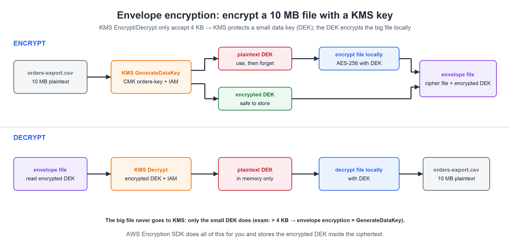
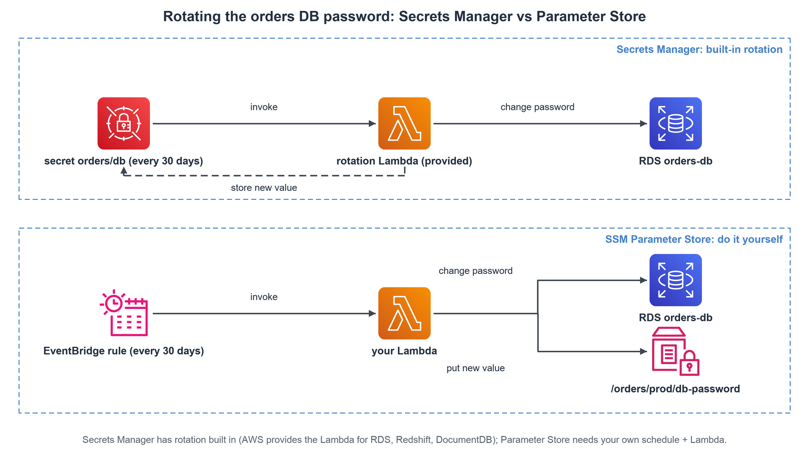

# Security & Encryption: KMS, SSM, Parameter Store, Shield, WAF

## Encryption Fundamentals

### Encryption in Flight (Transit)

- Protects data as it travels over a network.
- Typically uses TLS/SSL protocols (e.g., HTTPS).
- Relies on TLS certificates for establishing secure connections.
- Prevents Man-in-the-Middle (MITM) attacks.
- Flow: Client (username/password) → TLS encryption → encrypted payload → TLS decryption → HTTPS website (server)

### Encryption at Rest

- **Server-Side Encryption (SSE)**
    - Data is encrypted *after* being received by the server/service.
    - Data is decrypted by the server *before* being sent to the client.
    - Requires the server to manage or have access to encryption keys.
    - Flow: Object → HTTPS → AWS service (e.g. S3): object + data key → encryption → stored; encrypted object + data key → decryption → HTTPS → Object
- **Client-Side Encryption**
    - Data is encrypted by the client *before* sending it to the server.
    - Server stores the data in its encrypted form and cannot decrypt it.
    - Data must be decrypted by the receiving client.
    - Flow: Client: object + data key (client-side) → encryption → *store* in any storage service (FTP, S3, …) → *retrieve* → encrypted object + data key → decryption → object

## AWS KMS (Key Management Service)

### Overview

- Managed service for creating, managing, and controlling cryptographic keys across AWS. Central to many AWS service encryption features. Integrates with IAM and CloudTrail.
- Exam hint: "encryption" on an AWS service → almost always **KMS**.
- **IAM** authorizes key use; **CloudTrail** logs every key use (audit).
- Built into EBS, S3, RDS, SSM, Lambda env vars…; also callable directly (SDK/CLI).
- **Never keep secrets in plaintext in code** → encrypt them with KMS, store the ciphertext in code / env vars, decrypt at run time.

### KMS Keys (formerly CMKs - Customer Master Keys)

- **Key Types**
    - **Symmetric (AES-256)**: Single key for encryption/decryption. Used by most integrated AWS services. Key material never leaves KMS unencrypted.
    - **Asymmetric (RSA, ECC)**: Public/Private key pair for encryption/decryption OR signing/verification. Public key is downloadable.
        - Private key never leaves KMS unencrypted.
        - Use case: someone **outside AWS** (no KMS API access) encrypts with the public key; you decrypt inside KMS.
- **Key Management Options**
    - **AWS Owned Keys**: Used internally by AWS services (e.g., SSE-S3 default). Not manageable by user. Free.
    - **AWS Managed Keys**: Created by AWS for specific services (e.g., `aws/ebs`, `aws/rds`). Managed by AWS but visible to user. Automatic rotation (1 year). Free.
    - **Customer Managed Keys (CMK)**: Created by the user (or imported). Full control over key policy, lifecycle, rotation. Charged per key/month + API usage. Supports optional automatic rotation (1 year) or manual rotation. Imported keys support manual rotation only.
        - Course pricing: **$1 / key / month** (created or imported) + **$0.03 per 10,000 API calls**.
        - Customer managed rotation: automatic must be **enabled** (default every 365 days, configurable 90–2560 days) and **on-demand** rotation is also possible.
        - Imported key material: **manual** rotation only → create a new key and repoint the **alias** (`alias/orders-key`).

### KMS Key Policies

- Primary method to control access to CMKs (mandatory for CMKs).
- Define who can use (e.g., encrypt/decrypt) and who can administer the key.
- Enables cross-account key sharing.
- Like an S3 bucket policy, **but mandatory**: without a key policy statement, nobody (not even admins) can use the key.
- **Default key policy** (when you don't write one): gives the **account root** = whole account full access → IAM policies then decide who uses it.
- **Custom key policy**: name the users/roles that **use** the key and those that **administer** it; needed for **cross-account** use.
- `Principal` options in policies: AWS account / root, IAM role, role session, IAM user, federated user session, AWS service (`"Service": "s3.amazonaws.com"`), everyone (`"*"`).

### Multi-Region Keys

- Replicate keys with identical key material and ID across multiple regions.
    - Example: multi-Region primary key in `us-east-1` (`mrk-1234abcd…`) syncs to replica keys in `us-east-2` and `eu-west-1` with the same key ID.
- Allows encrypting in one region and decrypting in another seamlessly.
- Use Cases: Global client-side encryption (e.g., with DynamoDB/Aurora Global Tables), DR, multi-region applications.
    - DynamoDB Global Table: (1) encrypt attribute with primary MRK in us-east-1 → (2) put encrypted attribute → (3) global table replication → (4) get encrypted attribute in ap-southeast-2 → (5) decrypt with replica MRK
    - Aurora Global Database: same flow for an encrypted column

### Cross-Account / Cross-Region Use Cases

- **Copying Encrypted Snapshots/AMIs**: Requires sharing the KMS key via policy and re-encrypting in the target account/region.
    - EBS volume encrypted with KMS Key A (eu-west-2) → snapshot → KMS ReEncrypt with KMS Key B → snapshot/volume in ap-southeast-2
- **Copying an encrypted EBS snapshot to another account**
    - Snapshot must use a **customer managed key** (AWS managed keys cannot be shared).
    - Add the target account to that key's **key policy** → share the snapshot.
    - In the target account: **copy** the snapshot, re-encrypt with its **own** CMK → create the volume.
- **S3 Cross-Region Replication (CRR) with SSE-KMS**: Requires IAM role with decrypt/encrypt permissions for source/target keys.

### KMS APIs (Symmetric)

- **`Encrypt`** / **`Decrypt`**: up to **4 KB** of data (a password, a DEK…). KMS checks IAM, then encrypts/decrypts with the CMK.
- **`GenerateDataKey`**: returns a new data key (DEK) twice: **plaintext** + **encrypted under the CMK** → use now.
- **`GenerateDataKeyWithoutPlaintext`**: only the encrypted DEK → for later use (call `Decrypt` when needed).
- **`ReEncrypt`**: decrypt + encrypt with another key inside KMS (plaintext never leaves).
- **`GenerateRandom`**: random byte string.

### Envelope Encryption

- Data **> 4 KB** → cannot go through `Encrypt` → **envelope encryption** = **`GenerateDataKey`** (exam keyword).
- Encrypt: `GenerateDataKey` → encrypt file locally with plaintext DEK → drop plaintext DEK → store **encrypted file + encrypted DEK** together.
- Decrypt: `Decrypt` the encrypted DEK → decrypt file locally.
- 

### AWS Encryption SDK

- Library that **implements envelope encryption** for you (Java, Python, C, JavaScript) + a CLI.
- Puts the encrypted DEK **inside the ciphertext message** → one blob to store.
- **Data key caching**: reuse a DEK for several messages → fewer KMS calls (cheaper, avoids throttling), at a security cost.
    - `LocalCryptoMaterialsCache` with limits: max age, max bytes, max messages per key.

### KMS Request Quotas

- Over the quota → **`ThrottlingException`** → retry with **exponential backoff**.
- Cryptographic operations (`Encrypt`, `Decrypt`, `GenerateDataKey`, `ReEncrypt`…) **share one quota** per account/Region, including calls AWS makes **for you** (e.g. SSE-KMS on S3).
- Course numbers (symmetric, per second): 5,500 / 10,000 / 30,000 shared depending on Region; asymmetric much lower (RSA 500, ECC 300).
- Fixes: **DEK caching** (Encryption SDK), **S3 Bucket Key**, or request a quota increase (Service Quotas API / support).

### S3 Bucket Key (SSE-KMS)

- S3 gets a short-lived **bucket-level key** from KMS, then derives **data keys** for objects itself.
- → up to **99% fewer KMS calls** and **99% lower KMS cost**; fewer KMS events in CloudTrail.

## AWS CloudHSM

### Overview

- **KMS** = AWS runs the encryption **software**; **CloudHSM** = AWS gives you dedicated encryption **hardware** (HSM = Hardware Security Module).
- **You** fully manage the keys and HSM users (AWS cannot see or recover them).
- Tamper-resistant, **FIPS 140-2 Level 3**; symmetric + asymmetric (incl. SSL/TLS keys).
- Needs the **CloudHSM client** software (SSL connection); IAM only controls the **cluster** (create/delete), not the keys.
- No free tier. Good fit for **SSE-C** (you hold the keys) and Redshift encryption.

### High Availability & Integration

- Cluster of HSMs spread across **multiple AZs** → HA and durability.
- **KMS custom key store** backed by CloudHSM → EBS, S3, RDS… use keys living in your HSMs; usage still logged in CloudTrail.

### CloudHSM vs KMS

- **Tenancy**: KMS multi-tenant vs CloudHSM **single-tenant**.
- **Keys**: KMS has AWS owned / AWS managed / customer managed vs CloudHSM customer managed only.
- **Where**: KMS key is regional (multi-Region keys optional) vs CloudHSM lives **in your VPC** (share with VPC peering).
- **Access**: KMS uses **IAM** vs CloudHSM has its **own users and permissions** (+ MFA).
- **Extras**: CloudHSM offers SSL/TLS and Oracle TDE acceleration; KMS has a free tier, CloudHSM does not.
- HA: KMS is fully managed vs CloudHSM you add HSMs in several AZs.

## Secrets Management

### SSM Parameter Store

- Secure storage for configuration data and secrets (passwords, keys, etc.).
- Supports hierarchical organization (`/app/dev/db_pass`).
    - Example tree: `/orders/dev/db-url`, `/orders/dev/db-password`, `/orders/prod/…` → dev Lambda reads `/orders/dev/` with **`GetParametersByPath`**, prod Lambda reads `/orders/prod/`.
    - IAM can allow a path prefix only (`arn:aws:ssm:…:parameter/orders/prod/*`).
    - Special paths: `/aws/reference/secretsmanager/<secret-id>` (read a Secrets Manager secret through SSM) and public `/aws/service/ami-amazon-linux-latest/…` (latest AMI IDs).
- Serverless, scalable, simple SDK (`GetParameter`, `GetParameters`, `--with-decryption` for SecureString).
- Integrates with **CloudFormation**.
- Optional encryption using KMS.
- Version tracking of parameters.
- Access control via IAM.
- Notifications via EventBridge.
- **Tiers**: Standard (free, 4KB limit, 10k params, no policies) vs. Advanced (paid, 8KB limit, 100k params, supports policies).
    - Course: Advanced costs **$0.05 / parameter / month**; limits are per account and Region.
- **Parameter Policies (Advanced Tier)**: TTL/Expiration, Change Notifications via EventBridge.
    - `Expiration`: delete the parameter at a date (force rotating a password).
    - `ExpirationNotification`: EventBridge event before it expires.
    - `NoChangeNotification`: EventBridge event if the value was not changed for X days.
    - Several policies can be attached at once.
- **Use Case**: Store application config, retrieve dynamically.
- Flow: Application ⇄ (plaintext / encrypted configuration) ⇄ SSM Parameter Store → check IAM permissions; decryption service → AWS KMS

### AWS Secrets Manager

- Dedicated service for storing secrets.
- **Key Feature**: Automated secrets rotation capability (integrates with Lambda, RDS).
- Integration with RDS (MySQL, PostgreSQL, Aurora).
- Encrypts secrets using KMS.
- Supports Multi-Region Secrets replication.
- Generally preferred for database credentials due to auto-rotation.
- Rotation every **X days**; a **Lambda** generates and sets the new value.
- **Multi-Region secrets**: read **replicas** kept in sync with the primary; a replica can be **promoted** to a standalone secret (DR, multi-Region apps/DBs).

### Parameter Store vs Secrets Manager

- **Secrets Manager ($$$)**
    - **Built-in rotation** with Lambda; AWS **provides** the Lambda for RDS, Redshift, DocumentDB.
    - KMS encryption **mandatory**.
    - CloudFormation integration.
- **Parameter Store ($)**
    - Simple API, cheap / free.
    - **No native rotation** → build it: EventBridge schedule → your Lambda.
    - KMS encryption **optional** (SecureString).
    - CloudFormation integration; can read Secrets Manager secrets via `/aws/reference/secretsmanager/…`.
- 

### CloudFormation Dynamic References

- Template pulls a value at **create/update/delete** time: `'{{resolve:service-name:reference-key}}'`.
    - `{{resolve:ssm:/orders/prod/db-url:1}}` → plaintext String parameter.
    - `{{resolve:ssm-secure:/orders/prod/db-password:1}}` → SecureString (only some resource properties support it).
    - `{{resolve:secretsmanager:orders/db:SecretString:password}}` → secret (optional json-key, version stage, version id).
- **RDS master password, option 1**: `ManageMasterUserPassword: true` → RDS/Aurora **creates and rotates** the admin secret in Secrets Manager itself.
- **RDS master password, option 2**: `AWS::SecretsManager::Secret` generates it → DB references it with `resolve:secretsmanager` → `SecretTargetAttachment` links secret and DB (for rotation).

## AWS Certificate Manager (ACM)

### Overview

- Manages provisioning, management, and deployment of TLS/SSL certificates.
- Flow: User → HTTPS → ALB (ACM provisions and maintains TLS certs) → HTTP → Auto Scaling group of EC2 instances

### Function

- Enables HTTPS (encryption in flight).

### Certificate Types

- **Public Certificates**: Issued by ACM (via Amazon Trust Services CA) or imported. Free if issued by ACM. Automatic renewal for ACM-issued certs.
- **Private Certificates**: For internal use (Private CA feature).

### Validation

- DNS (preferred for automation) or Email.

### Imported Certificates

- Generated externally. **No** automatic renewal. Requires manual re-import. Expiration notifications via EventBridge / Config rule.
- Flow: ACM events (daily certificate expiry) or AWS Config rule events (non-compliance) → EventBridge → Lambda / SNS / SQS

### Integrations

- Used with ELB (ALB, NLB, CLB), CloudFront, API Gateway. *Cannot* be directly installed on EC2 instances.
- Example: ALB with HTTP → HTTPS redirect rule; ACM provisions and maintains TLS certs on the ALB

### Regionality

- Certificates used with CloudFront or Edge-Optimized API Gateway must be requested/imported in `us-east-1`. For Regional endpoints (ALB, Regional API Gateway), use certs in the same region.

## Network & Application Protection

### AWS WAF (Web Application Firewall)

- Protects web applications (Layer 7 - HTTP/S) from common exploits (SQL injection, XSS).
- Deployed on: CloudFront, ALB, API Gateway, AppSync, Cognito User Pool.
- Uses Web ACLs with rules based on IP sets, request components (headers, body, URI), geo-location, rate limits. Supports managed rule groups.

### AWS Shield

- Managed DDoS (Distributed Denial of Service) protection.
- **Shield Standard**: Free, automatic protection against common Layer 3/4 network attacks for all customers.
- **Shield Advanced**: Paid subscription ($3k/mo). Provides enhanced protection for specific resources (EC2, ELB, CF, Global Accelerator, R53), 24/7 DDoS Response Team (DRT) access, cost protection, and automatic Layer 7 mitigation using WAF.

### AWS Firewall Manager

- Centralized management of firewall rules (WAF, Shield Advanced, Security Groups, Network Firewall, R53 DNS Firewall) across AWS Organization accounts.
- Enforces consistent policies and simplifies compliance.

### DDoS Protection Best Practices

- **Edge**: Use CloudFront, Route 53, Global Accelerator.
- **Infrastructure**: Use Auto Scaling, ELB.
- **Application**: Use WAF (rate-based rules, managed rules), Shield Advanced.
- **Surface Reduction**: Hide backends (EC2, Lambda) behind CF/APIGW/ELB, use Security Groups/NACLs, protect APIs.

## Threat Detection & Data Security

### Amazon GuardDuty

- Intelligent threat detection service using ML and anomaly detection.
- Analyzes CloudTrail logs, VPC Flow Logs, DNS logs (optional EKS, RDS, EBS, Lambda, S3 logs) to identify threats (e.g., reconnaissance, compromised instances, account compromise).
- Agentless, one-click setup. Sends findings to EventBridge.
- Flow: VPC Flow Logs, CloudTrail Logs, DNS Logs (+ optional: S3 logs, EBS volumes, Lambda network activity, RDS & Aurora login activity, EKS audit logs & runtime monitoring) → GuardDuty → EventBridge → SNS / Lambda

### Amazon Inspector

- Automated vulnerability assessment service.
- Scans EC2 instances (via SSM agent), container images (in ECR), and Lambda functions for software vulnerabilities (CVEs) and unintended network exposure.
- Provides risk scores and integrates with Security Hub/EventBridge.
- Flow: Lambda / EC2 / ECR container image → Amazon Inspector → assessment run state & findings → Security Hub, EventBridge

### Amazon Macie

- Managed data security and privacy service using ML.
- Discovers, classifies, and helps protect sensitive data (like PII) stored in Amazon S3.
- Provides S3 security posture assessment (public buckets, encryption status) and alerts on sensitive data findings via EventBridge.
- Flow: S3 Bucket → *analyze* → Macie (discover sensitive data / PII) → *notify* → EventBridge → integrations
